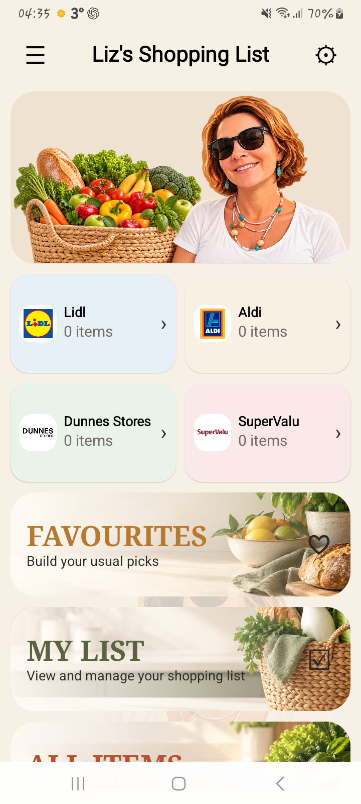
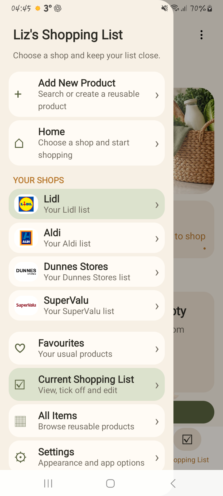

# Task 12: Visual refinement

**Date:** 2026-10-16 
**Branch:** `task12/visual-refinement` 
**Result:** Local checks, the Android 13 visual review and the corrected connected journey passed on Samsung SM-A127F. Hosted API 33 workflow run [38850508294](https://github.com/brunkonjaa/Liz-s-Shopping-App/actions/runs/38850508294) passed both jobs. API 37 instrumentation remains open.

## Result

Task 12 is based on `0448373`, the Task 11 production release. We installed and launched the signed Release build on a Samsung SM-A127F running Android 13. The selected screenshots below show the four shop logos on Home and in the navigation drawer.

## Changes

- Added local logos for the four default shops and optional offline images for custom shops. Shop image metadata is stored in SQLite and backup v3, with explicit v1/v2 migration support.
- Added section banners, the requested playful flavour-pack image, and layout changes that keep headings and shop names intact. All Items now sorts product names alphabetically without regard to case.
- Added Liz's derived portrait as the launcher icon, Android 12+ splash image and faint app background. Home shows her beside a basket of apples, vegetables and bread.
- No permissions or online services were added. The original family badge remains outside the repository.

## Shop logos on the phone

These screenshots were captured from the signed Release app on the Samsung SM-A127F running Android 13.

| Home | Navigation drawer |
| --- | --- |
|  |  |

## Verification

- `scripts/build-release.ps1` ran `clean testDebugUnitTest lintDebug assembleRelease --console=plain`: **BUILD SUCCESSFUL**. RulesTest: 36/36; StorageTest: 19/19; total: 55 passing. Lint: 0 errors, 16 warnings. The signed, optimized Release APK assembled.
- Installed and launched Release on SM-A127F / Android 13. A cold-launch screenshot showed Liz on the system splash; Home showed the portrait-and-basket composition. Home cards, drawer and Settings were rendered at 720x1600, density override 280 and font scale 1.1. `SHOP MANAGEMENT` wraps between words and keeps `MANAGEMENT` intact. All Items visibly begins Apples, then Bacon.
- The first connected journey attempt stopped before tests because the installed Release and test Debug signatures differ. After removing the Release and installing the test build, the journey exposed stale navigation assumptions: returning installations open the selected shop list, not Home, and the current shop button is labelled `Change shop` without the earlier arrow. The test now navigates through the drawer to Home, selects Lidl by its stable shop-card tag, and uses the current button label. The full journey passed on Samsung SM-A127F / Android 13: 1 test, 0 failures, 83.787 seconds, including committed SQLite readback after shop switching and recreation. The phone data was disposable test data and was reset for this run.
- Hosted API 33 Pixel 2 workflow run [38850508294](https://github.com/brunkonjaa/Liz-s-Shopping-App/actions/runs/38850508294) passed the build/security and Android 13 journey jobs.
- A local API 37 emulator attempt failed before test execution because Espresso could not reflectively find `InputManager.getInstance()` on API 37. API 37 instrumentation remains unverified. Backup/restore UI, custom image picker, dark mode, TalkBack, large-font and landscape coverage also remain unverified.

## Artifacts and acceptance

The Release APK is generated at `app/build/outputs/apk/release/app-release.apk` and remains ignored by Git. The two selected shop-logo screenshots are included under `docs/images/task12-shop-logos/`; raw captures remain local. Task 12 is **CONDITIONAL**: local tests, lint, Release assembly, Android 13 visual review and the corrected phone journey passed; the hosted API 33 workflow, API 37 instrumentation and listed coverage areas remain open.
